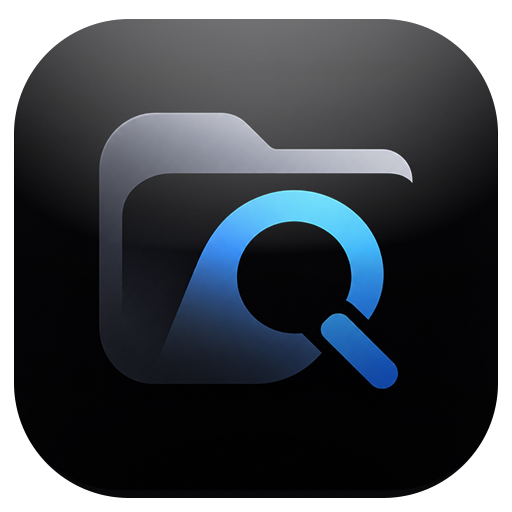
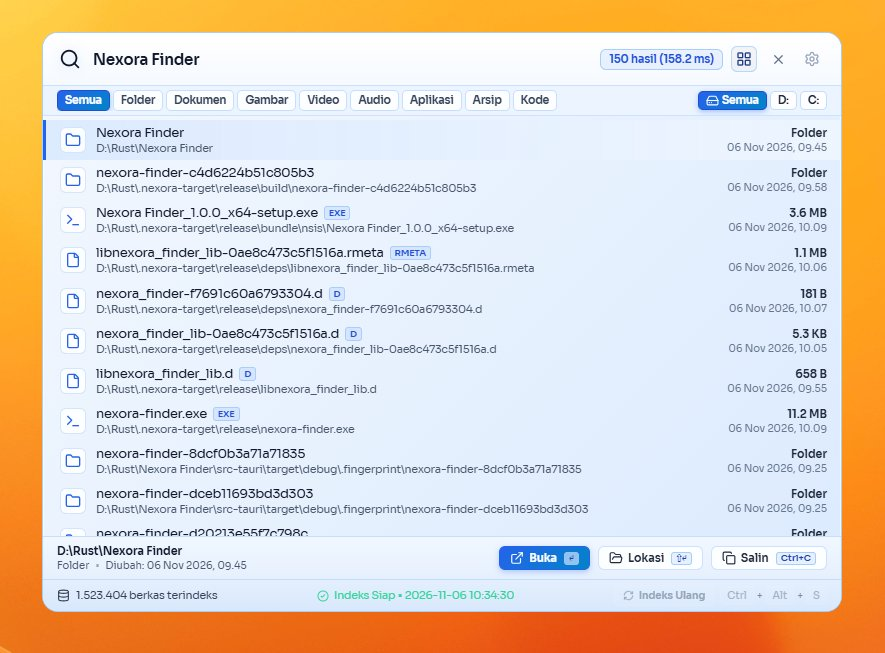
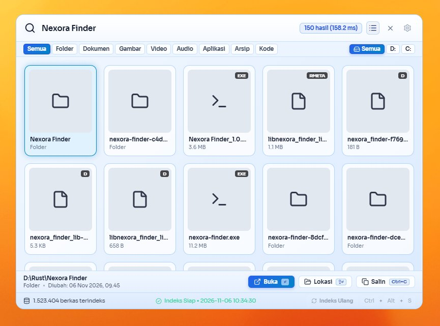

# ⚡ Nexora Finder

<div align="center">
  
  <h3>Pencarian Berkas & Folder Instan Super Cepat untuk Windows</h3>
  <p>Dibangun dengan performa tinggi <b>Rust</b>, engine <b>Tantivy</b>, dan antarmuka modern <b>Tauri + React</b> bergaya macOS Spotlight.</p>
</div>

---

## 🌟 Gambaran Umum (Overview)

**Nexora Finder** adalah aplikasi desktop pencari berkas dan folder berkecepatan tinggi yang dirancang khusus untuk Windows. Dengan memanfaatkan integrasi pembacaan cepat file sistem, database lokal SQLite, serta mesin pencari teks penuh (**Tantivy Full-Text Indexing**), Nexora Finder mampu mencari di antara jutaan berkas dalam hitungan milidetik (< 1 ms).

Dilengkapi dengan desain antarmuka bergaya **Spotlight Glassmorphism** (Mode Terang & Gelap), animasi dinamis saat mengetik, dukungan thumbnail instan, serta integrasi tombol pintas global (*global shortcut*).

---

## 📸 Tampilan Antarmuka (Screenshots)

<div align="center">
  <h3>Mode Tampilan Daftar (List View)</h3>
  
  <br/><br/>
  <h3>Mode Tampilan Thumbnail (Grid View)</h3>
  
</div>

---

## ✨ Fitur Utama (Key Features)

- ⚡ **Pencarian Super Instan (< 1 ms):** Menggunakan mesin indeks Tantivy berkecepatan tinggi yang mampu menangani jutaan file tanpa jeda.
- 🔍 **Pencarian Cerdas Toleran Saltik (Fuzzy Search):** Tetap menemukan berkas secara akurat meskipun pengguna salah mengetik (*typo*) atau hanya mengingat sebagian nama berkas.
- 🎯 **Mode Jendela Spotlight Adaptif:** Jendela otomatis ramping saat awal dibuka (hanya bilah pencarian), dan melebar ke tengah secara mulus saat mulai mengetik hasil pencarian.
- 🖼️ **Dua Mode Tampilan (List & Grid View):**
  - **Mode Daftar (List View):** Informasi detail lengkap seperti jalur folder, ekstensi, ukuran file, dan tanggal modifikasi.
  - **Mode Thumbnail (Grid View):** Tampilan kartu persegi 1:1 proporsional dengan pratinjau gambar instan.
- 🗂️ **Filter Kategori Cepat:** Filter berkas instan berdasarkan kategori: *Folder, Dokumen, Gambar, Video, Audio, Aplikasi, Arsip, dan Kode*.
- 💾 **Filter Spesifik Drive:** Pilihan untuk membaca seluruh drive (All) atau mengisolasi pencarian hanya pada drive tertentu (C:, D:, dll).
- 🖱️ **Menu Klik Kanan Kustom (Context Menu):**
  - **Buka:** Membuka berkas dengan aplikasi default.
  - **Buka dengan... (Open with):** Memunculkan dialog resmi Windows untuk memilih aplikasi pembuka.
  - **Buka lokasi berkas (Open file location):** Membuka File Explorer dan langsung menyorot posisi file.
  - **Salin jalur lengkap:** Menyalin path direktori ke clipboard.
- 🎨 **Tema Elegan (Light & Dark Mode):** Dilengkapi aksen gradien biru modern dengan efek blur kaca frosted transparan.
- 🪟 **Auto Minimize Cerdas:**
  - Menekan `Enter` atau `Double Click` pada file langsung meminimalkan jendela secara otomatis.
  - Klik di luar area jendela otomatis menyembunyikan aplikasi kembali ke background/tray.
- ⌨️ **Tombol Pintas Global (Global Shortcuts):**
  - Tekan `Ctrl + Alt + S` atau `Alt + Space` kapan saja untuk langsung memunculkan / menyembunyikan jendela pencarian.
  - Navigasi keyboard penuh (`Panah Atas / Bawah / Kiri / Kanan`, `Enter`, `Shift + Enter`, `Esc`).

---

## 🛠️ Teknologi yang Digunakan (Tech Stack)

- **Backend:** [Rust](https://www.rust-lang.org/) — Kecepatan native, keamanan memori, serta integrasi langsung ke Windows Shell API (`shell32.dll`, Win32 API).
- **Search Engine:** [Tantivy](https://github.com/quickwit-oss/tantivy) — Mesin pencarian teks berkinerja tinggi yang terinspirasi dari Apache Lucene.
- **Database Metadata:** [SQLite](https://www.sqlite.org/) (via `rusqlite` bundled) — Penyimpanan riwayat dan metadata file.
- **Frontend Framework:** [React 19](https://react.dev/) + [TypeScript](https://www.typescriptlang.org/) + [Vite](https://vitejs.dev/).
- **Desktop Runtime:** [Tauri 2.0](https://v2.tauri.app/) — Ringan, konsumsi RAM sangat minim, dan menghasilkan binary portable tanpa dependensi runtime besar.
- **Desain & Ikon:** Custom CSS Modern Glassmorphism + [Lucide Icons](https://lucide.dev/).

---

## 🚀 Cara Menjalankan & Membangun (Development & Build)

### Prasyarat
- [Node.js](https://nodejs.org/) (v18+) & `npm`
- [Rust & Cargo](https://rustup.rs/) (versi stable terbaru untuk target `x86_64-pc-windows-msvc` atau `x86_64-pc-windows-gnu`)

### Instalasi Dependensi
```bash
# Clone repositori
git clone https://github.com/nexora-ctrl/nexora-finder.git
cd nexora-finder

# Install dependencies frontend
npm install
```

### Menjalankan Mode Pengembangan (Dev Mode)
```bash
npm run tauri dev
```

### Membangun File Executable Rilis (Production Build)
```bash
# Build binary mandiri (Standalone .exe)
npm run tauri build -- --no-bundle
```
File executable mandiri siap pakai akan dihasilkan di folder target release dan dapat langsung dijalankan tanpa perlu proses instalasi.

---

## 📄 Lisensi (License)

Proyek ini dilisensikan di bawah lisensi MIT. Silakan gunakan dan kembangkan sesuai kebutuhan Anda.
